# Poly Haven: Pure Skies HDRIs

**59 assets from [Poly Haven](https://polyhaven.com), dedicated to the public domain under [CC0](https://polyhaven.com/license).** Use them in any game, free or paid, and change them however you like; no credit is needed.

HDRI skies and environments as 1K and 2K Radiance `.hdr` images, for lighting and backgrounds. 341.1 MB in all.

This is a copy kept by [zuujis-cc0](https://github.com/zuujis-cc0) so game makers can take single files from GitHub. It is not made by or affiliated with Poly Haven: the originals, often in more formats and higher resolutions, are on [polyhaven.com](https://polyhaven.com). If they help you, consider [supporting Poly Haven](https://www.patreon.com/polyhaven/overview).

Every file is listed in [MANIFEST.tsv](MANIFEST.tsv) with its size and SHA-256. More free assets: [the Zuujis collection](https://github.com/zuujis-cc0/free-game-assets#readme).

| | | | |
| :-: | :-: | :-: | :-: |
| <a href="aristea_wreck_puresky">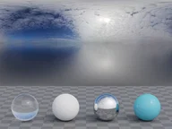</a> <b><a href="aristea_wreck_puresky">Aristea Wreck (Pure Sky)</a></b> by Greg Zaal, Jarod Guest · <a href="https://polyhaven.com/a/aristea_wreck_puresky">source</a> | <a href="autumn_field_puresky">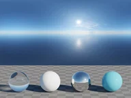</a> <b><a href="autumn_field_puresky">Autumn Field (Pure Sky)</a></b> by Jarod Guest, Sergej Majboroda · <a href="https://polyhaven.com/a/autumn_field_puresky">source</a> | <a href="belfast_sunset_puresky">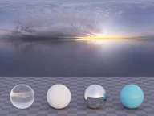</a> <b><a href="belfast_sunset_puresky">Belfast Sunset (Pure Sky)</a></b> by Dimitrios Savva, Greg Zaal, Jarod Guest · <a href="https://polyhaven.com/a/belfast_sunset_puresky">source</a> |  <b><a href="citrus_orchard_puresky">Citrus Orchard (Pure Sky)</a></b> by Dimitrios Savva, Jarod Guest · <a href="https://polyhaven.com/a/citrus_orchard_puresky">source</a> |
| <a href="citrus_orchard_road_puresky">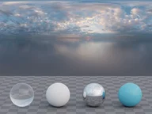</a> <b><a href="citrus_orchard_road_puresky">Citrus Orchard Road (Pure Sky)</a></b> by Dimitrios Savva, Jarod Guest · <a href="https://polyhaven.com/a/citrus_orchard_road_puresky">source</a> | <a href="drackenstein_quarry_puresky">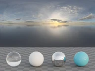</a> <b><a href="drackenstein_quarry_puresky">Drackenstein Quarry (Pure Sky)</a></b> by Andreas Mischok, Jarod Guest · <a href="https://polyhaven.com/a/drackenstein_quarry_puresky">source</a> | <a href="drakensberg_solitary_mountain_puresky">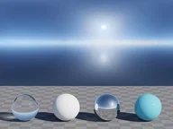</a> <b><a href="drakensberg_solitary_mountain_puresky">Drakensberg Solitary Mountain (Pure Sky)</a></b> by Dimitrios Savva, Jarod Guest · <a href="https://polyhaven.com/a/drakensberg_solitary_mountain_puresky">source</a> | <a href="evening_road_01_puresky">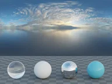</a> <b><a href="evening_road_01_puresky">Evening Road 01 (Pure Sky)</a></b> by Jarod Guest, Sergej Majboroda · <a href="https://polyhaven.com/a/evening_road_01_puresky">source</a> |
| <a href="farm_field_puresky">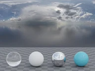</a> <b><a href="farm_field_puresky">Farm Field (Pure Sky)</a></b> by Dimitrios Savva, Jarod Guest · <a href="https://polyhaven.com/a/farm_field_puresky">source</a> |  <b><a href="hilly_terrain_01_puresky">Hilly Terrain 01 (Pure Sky)</a></b> by Jarod Guest, Sergej Majboroda · <a href="https://polyhaven.com/a/hilly_terrain_01_puresky">source</a> |  <b><a href="industrial_sunset_02_puresky">Industrial Sunset 02 (Pure Sky)</a></b> by Jarod Guest, Sergej Majboroda · <a href="https://polyhaven.com/a/industrial_sunset_02_puresky">source</a> | <a href="industrial_sunset_puresky">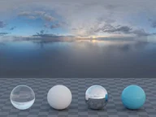</a> <b><a href="industrial_sunset_puresky">Industrial Sunset (Pure Sky)</a></b> by Jarod Guest, Sergej Majboroda · <a href="https://polyhaven.com/a/industrial_sunset_puresky">source</a> |
|  <b><a href="kloofendal_28d_misty_puresky">Kloofendal 28d Misty (Pure Sky)</a></b> by Greg Zaal, Jenelle van Heerden · <a href="https://polyhaven.com/a/kloofendal_28d_misty_puresky">source</a> | <a href="kloofendal_38d_partly_cloudy_puresky">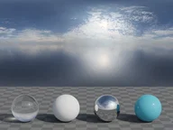</a> <b><a href="kloofendal_38d_partly_cloudy_puresky">Kloofendal 38d Partly Cloudy (Pure Sky)</a></b> by Greg Zaal, Jarod Guest · <a href="https://polyhaven.com/a/kloofendal_38d_partly_cloudy_puresky">source</a> |  <b><a href="kloofendal_43d_clear_puresky">Kloofendal 43d Clear (Pure Sky)</a></b> by Greg Zaal · <a href="https://polyhaven.com/a/kloofendal_43d_clear_puresky">source</a> |  <b><a href="kloofendal_48d_partly_cloudy_puresky">Kloofendal 48d Partly Cloudy (Pure Sky)</a></b> by Greg Zaal, Jarod Guest · <a href="https://polyhaven.com/a/kloofendal_48d_partly_cloudy_puresky">source</a> |
| <a href="kloofendal_misty_morning_puresky">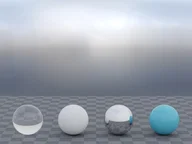</a> <b><a href="kloofendal_misty_morning_puresky">Kloofendal Misty Morning (Pure Sky)</a></b> by Greg Zaal · <a href="https://polyhaven.com/a/kloofendal_misty_morning_puresky">source</a> | <a href="kloofendal_overcast_puresky">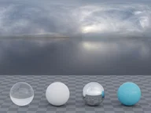</a> <b><a href="kloofendal_overcast_puresky">Kloofendal Overcast (Pure Sky)</a></b> by Greg Zaal · <a href="https://polyhaven.com/a/kloofendal_overcast_puresky">source</a> |  <b><a href="kloppenheim_01_puresky">Kloppenheim 01 (Pure Sky)</a></b> by Greg Zaal, Jarod Guest · <a href="https://polyhaven.com/a/kloppenheim_01_puresky">source</a> |  <b><a href="kloppenheim_02_puresky">Kloppenheim 02 (Pure Sky)</a></b> by Greg Zaal, Jarod Guest · <a href="https://polyhaven.com/a/kloppenheim_02_puresky">source</a> |
|  <b><a href="kloppenheim_03_puresky">Kloppenheim 03 (Pure Sky)</a></b> by Greg Zaal, Jarod Guest · <a href="https://polyhaven.com/a/kloppenheim_03_puresky">source</a> | <a href="kloppenheim_05_puresky">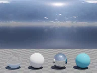</a> <b><a href="kloppenheim_05_puresky">Kloppenheim 05 (Pure Sky)</a></b> by Greg Zaal, Jarod Guest · <a href="https://polyhaven.com/a/kloppenheim_05_puresky">source</a> | <a href="kloppenheim_06_puresky">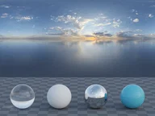</a> <b><a href="kloppenheim_06_puresky">Kloppenheim 06 (Pure Sky)</a></b> by Greg Zaal, Jarod Guest · <a href="https://polyhaven.com/a/kloppenheim_06_puresky">source</a> | <a href="kloppenheim_07_puresky">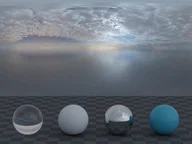</a> <b><a href="kloppenheim_07_puresky">Kloppenheim 07 (Pure Sky)</a></b> by Greg Zaal, Jarod Guest · <a href="https://polyhaven.com/a/kloppenheim_07_puresky">source</a> |
|  <b><a href="lonely_road_afternoon_puresky">Lonely Road Afternoon (Pure Sky)</a></b> by Dimitrios Savva, Jarod Guest · <a href="https://polyhaven.com/a/lonely_road_afternoon_puresky">source</a> |  <b><a href="mpumalanga_veld_puresky">Mpumalanga Veld (Pure Sky)</a></b> by Greg Zaal, Jarod Guest · <a href="https://polyhaven.com/a/mpumalanga_veld_puresky">source</a> | <a href="mud_road_puresky">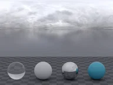</a> <b><a href="mud_road_puresky">Mud Road (Pure Sky)</a></b> by Jarod Guest, Sergey Rudavin · <a href="https://polyhaven.com/a/mud_road_puresky">source</a> | <a href="overcast_soil_puresky">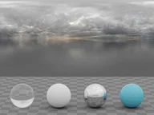</a> <b><a href="overcast_soil_puresky">Overcast Soil (Pure Sky)</a></b> by Jarod Guest, Sergej Majboroda · <a href="https://polyhaven.com/a/overcast_soil_puresky">source</a> |
|  <b><a href="pizzo_pernice_puresky">Pizzo Pernice (Pure Sky)</a></b> by Andreas Mischok, Jarod Guest · <a href="https://polyhaven.com/a/pizzo_pernice_puresky">source</a> |  <b><a href="quarry_01_puresky">Quarry 01 (Pure Sky)</a></b> by Jarod Guest, Sergej Majboroda · <a href="https://polyhaven.com/a/quarry_01_puresky">source</a> | <a href="quarry_04_puresky">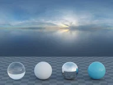</a> <b><a href="quarry_04_puresky">Quarry 04 (Pure Sky)</a></b> by Jarod Guest, Sergej Majboroda · <a href="https://polyhaven.com/a/quarry_04_puresky">source</a> | <a href="qwantani_afternoon_puresky">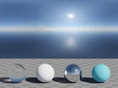</a> <b><a href="qwantani_afternoon_puresky">Qwantani Afternoon (Pure Sky)</a></b> by Greg Zaal, Jarod Guest · <a href="https://polyhaven.com/a/qwantani_afternoon_puresky">source</a> |
| <a href="qwantani_dawn_puresky">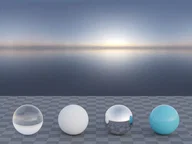</a> <b><a href="qwantani_dawn_puresky">Qwantani Dawn (Pure Sky)</a></b> by Greg Zaal, Jarod Guest · <a href="https://polyhaven.com/a/qwantani_dawn_puresky">source</a> | <a href="qwantani_dusk_1_puresky">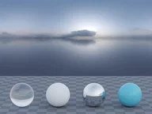</a> <b><a href="qwantani_dusk_1_puresky">Qwantani Dusk 1 (Pure Sky)</a></b> by Greg Zaal, Jarod Guest · <a href="https://polyhaven.com/a/qwantani_dusk_1_puresky">source</a> |  <b><a href="qwantani_dusk_2_puresky">Qwantani Dusk 2 (Pure Sky)</a></b> by Greg Zaal, Jarod Guest · <a href="https://polyhaven.com/a/qwantani_dusk_2_puresky">source</a> | <a href="qwantani_late_afternoon_puresky">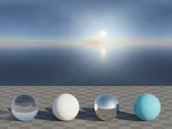</a> <b><a href="qwantani_late_afternoon_puresky">Qwantani Late Afternoon (Pure Sky)</a></b> by Greg Zaal, Jarod Guest · <a href="https://polyhaven.com/a/qwantani_late_afternoon_puresky">source</a> |
| <a href="qwantani_mid_morning_puresky">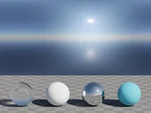</a> <b><a href="qwantani_mid_morning_puresky">Qwantani Mid Morning (Pure Sky)</a></b> by Greg Zaal, Jarod Guest · <a href="https://polyhaven.com/a/qwantani_mid_morning_puresky">source</a> | <a href="qwantani_moon_noon_puresky">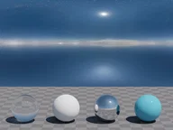</a> <b><a href="qwantani_moon_noon_puresky">Qwantani Moon Noon (Pure Sky)</a></b> by Greg Zaal, Jarod Guest · <a href="https://polyhaven.com/a/qwantani_moon_noon_puresky">source</a> |  <b><a href="qwantani_moonrise_puresky">Qwantani Moonrise (Pure Sky)</a></b> by Greg Zaal, Jarod Guest · <a href="https://polyhaven.com/a/qwantani_moonrise_puresky">source</a> | <a href="qwantani_morning_puresky">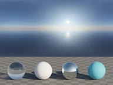</a> <b><a href="qwantani_morning_puresky">Qwantani Morning (Pure Sky)</a></b> by Jarod Guest · <a href="https://polyhaven.com/a/qwantani_morning_puresky">source</a> |
| <a href="qwantani_night_puresky">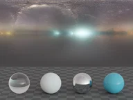</a> <b><a href="qwantani_night_puresky">Qwantani Night (Pure Sky)</a></b> by Greg Zaal, Jarod Guest · <a href="https://polyhaven.com/a/qwantani_night_puresky">source</a> | <a href="qwantani_noon_puresky">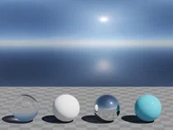</a> <b><a href="qwantani_noon_puresky">Qwantani Noon (Pure Sky)</a></b> by Greg Zaal, Jarod Guest · <a href="https://polyhaven.com/a/qwantani_noon_puresky">source</a> |  <b><a href="qwantani_puresky">Qwantani (Pure Sky)</a></b> by Greg Zaal, Jarod Guest · <a href="https://polyhaven.com/a/qwantani_puresky">source</a> | <a href="qwantani_sunrise_puresky">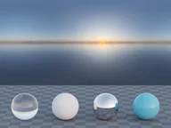</a> <b><a href="qwantani_sunrise_puresky">Qwantani Sunrise (Pure Sky)</a></b> by Greg Zaal, Jarod Guest · <a href="https://polyhaven.com/a/qwantani_sunrise_puresky">source</a> |
|  <b><a href="qwantani_sunset_puresky">Qwantani Sunset (Pure Sky)</a></b> by Greg Zaal, Jarod Guest · <a href="https://polyhaven.com/a/qwantani_sunset_puresky">source</a> |  <b><a href="rocky_ridge_puresky">Rocky Ridge (Pure Sky)</a></b> by Greg Zaal, Jarod Guest · <a href="https://polyhaven.com/a/rocky_ridge_puresky">source</a> |  <b><a href="rosendal_park_sunset_puresky">Rosendal Park Sunset (Pure Sky)</a></b> by Dimitrios Savva, Jarod Guest · <a href="https://polyhaven.com/a/rosendal_park_sunset_puresky">source</a> |  <b><a href="rustig_koppie_puresky">Rustig Koppie (Pure Sky)</a></b> by Greg Zaal, Jarod Guest · <a href="https://polyhaven.com/a/rustig_koppie_puresky">source</a> |
| <a href="scythian_tombs_puresky">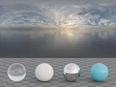</a> <b><a href="scythian_tombs_puresky">Scythian Tombs (Pure Sky)</a></b> by Jarod Guest, Sergej Majboroda · <a href="https://polyhaven.com/a/scythian_tombs_puresky">source</a> | <a href="snow_field_2_puresky">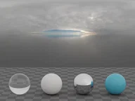</a> <b><a href="snow_field_2_puresky">Snow Field 2 (Pure Sky)</a></b> by Jarod Guest, Sergej Majboroda · <a href="https://polyhaven.com/a/snow_field_2_puresky">source</a> | <a href="snow_field_puresky">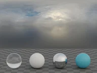</a> <b><a href="snow_field_puresky">Snow Field (Pure Sky)</a></b> by Jarod Guest, Sergej Majboroda · <a href="https://polyhaven.com/a/snow_field_puresky">source</a> |  <b><a href="sunflowers_puresky">Sunflowers (Pure Sky)</a></b> by Jarod Guest, Sergej Majboroda · <a href="https://polyhaven.com/a/sunflowers_puresky">source</a> |
|  <b><a href="syferfontein_0d_clear_puresky">Syferfontein 0d Clear (Pure Sky)</a></b> by Greg Zaal, Jarod Guest · <a href="https://polyhaven.com/a/syferfontein_0d_clear_puresky">source</a> | <a href="syferfontein_18d_clear_puresky">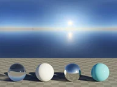</a> <b><a href="syferfontein_18d_clear_puresky">Syferfontein 18d Clear (Pure Sky)</a></b> by Greg Zaal, Jarod Guest · <a href="https://polyhaven.com/a/syferfontein_18d_clear_puresky">source</a> |  <b><a href="syferfontein_1d_clear_puresky">Syferfontein 1d Clear (Pure Sky)</a></b> by Greg Zaal, Jarod Guest · <a href="https://polyhaven.com/a/syferfontein_1d_clear_puresky">source</a> |  <b><a href="syferfontein_6d_clear_puresky">Syferfontein 6d Clear (Pure Sky)</a></b> by Greg Zaal, Jarod Guest · <a href="https://polyhaven.com/a/syferfontein_6d_clear_puresky">source</a> |
|  <b><a href="table_mountain_1_puresky">Table Mountain 1 (Pure Sky)</a></b> by Greg Zaal, Jarod Guest · <a href="https://polyhaven.com/a/table_mountain_1_puresky">source</a> |  <b><a href="table_mountain_2_puresky">Table Mountain 2 (Pure Sky)</a></b> by Greg Zaal, Jarod Guest · <a href="https://polyhaven.com/a/table_mountain_2_puresky">source</a> | <a href="wasteland_clouds_puresky">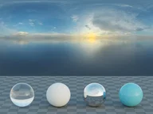</a> <b><a href="wasteland_clouds_puresky">Wasteland Clouds (Pure Sky)</a></b> by Jarod Guest, Sergej Majboroda · <a href="https://polyhaven.com/a/wasteland_clouds_puresky">source</a> |  |

---

Kept up to date by this repository's own [update workflow](.github/workflows/update.yml), with code and plan from [cc0-mirror](https://github.com/zuujis-cc0/cc0-mirror). Something wrong? [Open an issue there](https://github.com/zuujis-cc0/cc0-mirror/issues/new) or use the [private report form](https://games.zuujis.com/report).
